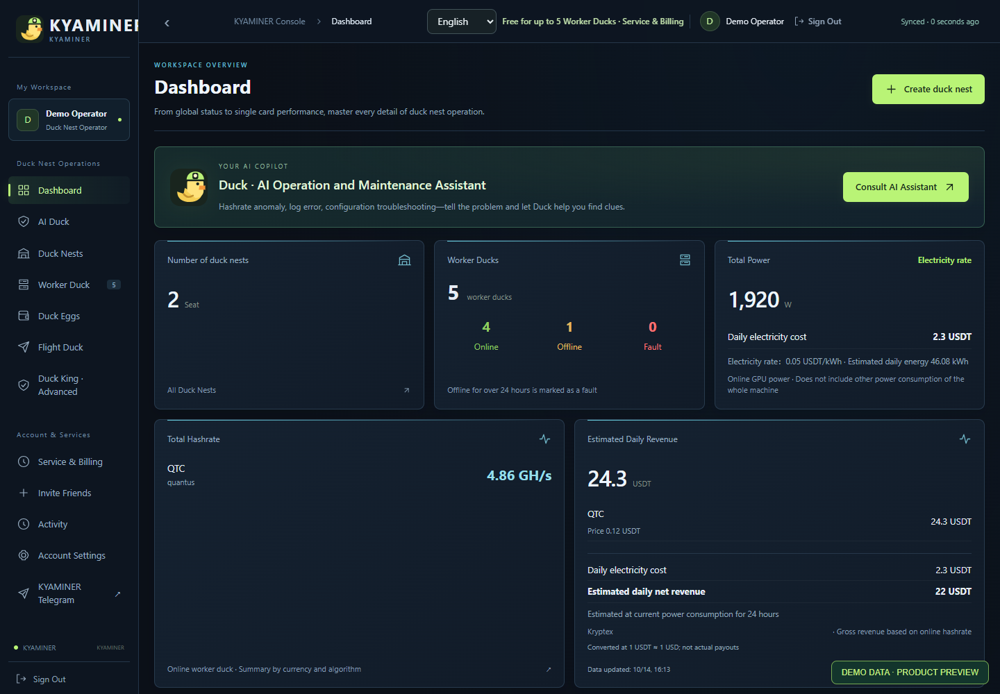
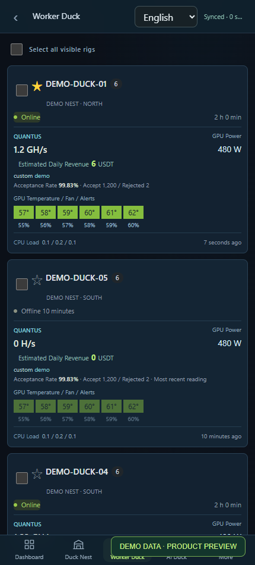
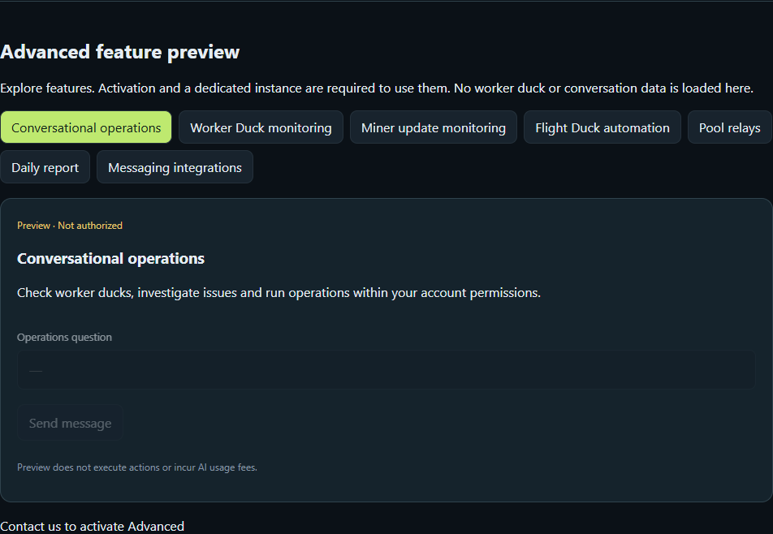

# 🦆 KYAMINER · 矿鸭

### 每个鸭子窝，都有一只 AI 鸭子在守候。

**5 台以内基础管理免费 · 支持 HiveOS 设备接入 · AI 辅助运维**

## [立即进入矿鸭 →](https://kyaminer.com/)

集中查看矿机、管理飞行表与超频，用 AI 协助排查问题。在电脑和手机上管理你的矿场。

[访问矿鸭](https://kyaminer.com/) · [加入 Telegram 社区](https://t.me/+xdKYKNbnFSM0NGNl) · [English](README.en.md) · [接入指南](docs/getting-started.md)

> 这是矿鸭的产品介绍、使用文档和问题反馈仓库。矿鸭是商业托管服务，核心源码不公开；本仓库不提供自部署程序。

## 看看矿鸭

以下为实际界面搭配虚构演示数据，不是客户数据，也不代表真实收益或收益承诺。

### 工作台：算力、在线情况、收益与电费

### 手机端：随时查看工兵鸭

### 鸭王：先看功能，再决定是否开通

未授权账号可浏览功能预览；执行操作需要开通并绑定独立实例。AI 额度与进阶授权单独管理。

[进入网站](https://kyaminer.com/) · [从一台设备开始接入](docs/getting-started.md)

## 可以做什么

| 功能 | 用途 |
| --- | --- |
| 矿场与矿机管理 | 多矿场管理，查看在线、离线、故障和 GPU 状态 |
| 飞行表 | 管理钱包与矿池配置，导入 HiveOS 飞行表，选择矿机下发 |
| 超频与温控 | 管理超频模板、单卡参数和智能温控，查看执行记录 |
| 日常运维 | 查看挖矿日志、运行命令，按需开启交互终端 |
| AI 鸭子 | 通过对话协助分析矿机，并在账号权限范围内使用运维工具 |
| 鸭王进阶功能 | 矿机监控、日报、锄头更新监控及自动化配置；以账号开放功能为准 |
| 工作台 | 按算法查看总算力及历史曲线，估算收益、电费与净收益 |
| 移动端与语言 | 手机浏览器访问，中英文切换 |

## 免费额度、账号时长与授权

界面中，**鸭子窝**指矿场，**工兵鸭**指矿机，**飞行鸭**指飞行表，**鸭蛋**指钱包管理。

| 账号情况 | 使用规则 |
| --- | --- |
| 拥有 0–5 台工兵鸭（含第 5 台） | 基础设备管理免费，不受账号时长到期限制 |
| 拥有超过 5 台，账号时长有效 | 可正常下发飞行鸭，账号时长继续计时 |
| 拥有超过 5 台，账号时长已到期 | 仅暂停下发飞行鸭，其他功能仍按原有权限使用 |

- 数量按账号拥有的设备总数计算，包含离线设备，不计其他账号授权共享的设备。
- 时长到期不会停止正在运行的挖矿任务；查看状态、日志、超频和重启等其他操作不因本项限制停用。
- 飞行鸭限制适用于网页、批量操作、鸭王及自动更新；已排队但尚未下发的任务在实际下发时也会检查。保存或编辑飞行鸭不受此项限制。
- **目前不自动扣费。** 账号时长继续计时，已有充值与赠送记录保留。
- **AI 鸭子额度、鸭王进阶授权单独管理**，不包含在 5 台免费设备额度中。
- 未授权用户可以浏览鸭王进阶功能预览，但不能使用操作功能；开通并绑定独立实例后才能使用。预览不读取真实设备或对话数据，不产生 AI 调用费用。

## 高阶版本 · 独立部署

高阶版本提供单独部署服务，可接入第三方聊天软件，通过熟悉的聊天入口查看矿场情况、接收告警与日报，并使用账号授权范围内的运维功能。

具体聊天平台、部署环境和可用功能按实际适配情况确认。独立部署由服务方提供，不代表公开核心源码或提供开源自部署安装包。可通过 [Telegram 社区](https://t.me/+xdKYKNbnFSM0NGNl) 联系咨询。

## 从现有矿机开始

矿鸭支持接入运行 HiveOS 的矿机。登录后创建矿场，在矿场中生成该矿场专属的接入命令，再到你自己的矿机上执行。

建议先接入一台测试矿机，确认设备状态、飞行表和超频设置后，再逐步接入更多设备。[查看完整步骤](docs/getting-started.md)。

## 算力与收益

不同算法分别统计，不直接相加。收益当前参考 Kryptex 支持币种的数据，属于估算，不代表矿池实际结算。电费按在线 GPU 功耗和用户设置的 USDT/kWh 电价估算，不含 CPU、主板等额外耗电。

## 反馈问题

请在本仓库 Issues 中描述复现步骤、预期行为及实际结果。不要上传密码、API Key、矿场接入命令、钱包配置或含私人信息的日志。[反馈说明](SUPPORT.md)

## 与 HiveOS 的关系

KYAMINER 是独立项目，不隶属于 HiveOS，也不代表获得其背书。相关产品名称及商标属于各自权利人。
