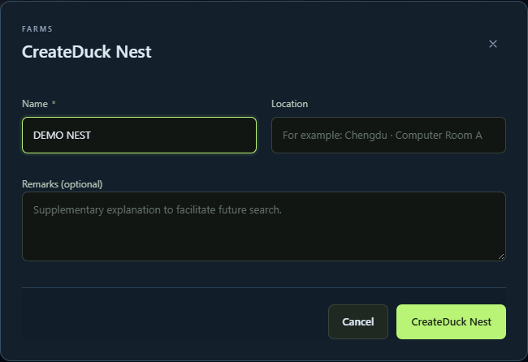
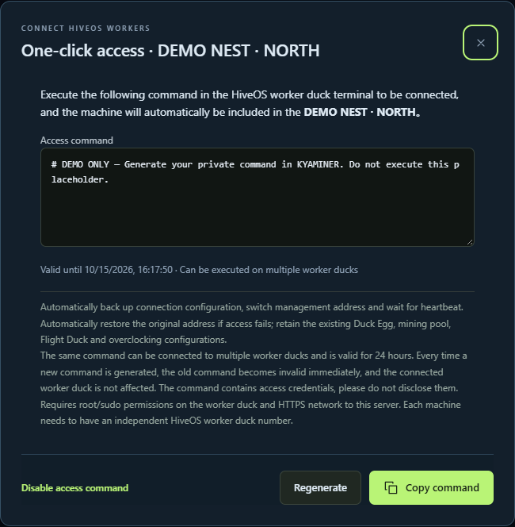

# A 3-minute enrollment guide: your first Worker Duck

[Open KYAMINER](https://kyaminer.com/) · [中文](getting-started.md) · [Project home](../README.en.md)

Allow about 3 minutes to read this guide. Actual enrollment time depends on your network and device. All screenshots use demonstration data; the command field contains a non-executable placeholder.

## Before you start

Use a HiveOS rig you own or are authorized to manage, with terminal access and root/sudo privileges. It must reach KYAMINER over HTTPS and have its own HiveOS rig ID. Start with one test rig and retain a backup of your existing configuration.

Interface terms: Duck Nest = farm; Worker Duck = rig; Flight Duck = flight sheet; Duck Eggs = wallet management.

## 1. Register or sign in

Visit [kyaminer.com](https://kyaminer.com/). Create an account or sign in, and select English or Chinese from the language switcher. Basic device management is free for up to five rigs. AI credits and Advanced access are separate.

## 2. Create a Duck Nest

Open Duck Nests, select Create, enter a recognizable name and save. Location and notes are optional.

## 3. Generate and run your enrollment command

Select One-click access for the target Duck Nest. Check its name, then copy the generated command and run it in the target HiveOS rig's terminal. Wait for the terminal result.

**Do not copy the screenshot text. Generate the real command inside your own account and target Duck Nest.** Enrollment commands contain credentials. Never publish them on GitHub or in public chats.

Enrollment backs up connection settings, changes the management endpoint and waits for a heartbeat while preserving existing mining configuration. Avoid changing flight sheets or overclock settings at the same time as validating enrollment.

The dialog shows expiry, currently 24 hours. A command can enroll multiple rigs. Regenerating it invalidates the old command without affecting rigs already enrolled. You can also disable the enrollment command.

## 4. Confirm your Worker Duck is online

Open Worker Ducks and select the target Duck Nest. Check the name, online status, GPU count, hashrate, temperature and fan readings. The page refreshes automatically.

Confirm that the first rig is reporting correctly before enrolling additional devices. Check execution receipts after operations; saving a configuration does not mean it has been applied successfully.

## Troubleshooting

| Symptom | First check |
| --- | --- |
| Expired or invalid command | Generate a new command in the target Duck Nest |
| Permission denied | Confirm root/sudo access on the rig |
| Network or certificate error | Check device time, DNS and HTTPS connectivity; do not bypass certificate verification |
| Missing from the expected Duck Nest | Check the account, target nest and terminal enrollment result |
| Online but no hashrate | Review mining logs, flight-sheet configuration and miner status |

See [support guidelines](../SUPPORT.md) before sharing diagnostics. Remove credentials, private addresses and enrollment commands.

[Sign in and enroll your first rig →](https://kyaminer.com/)
